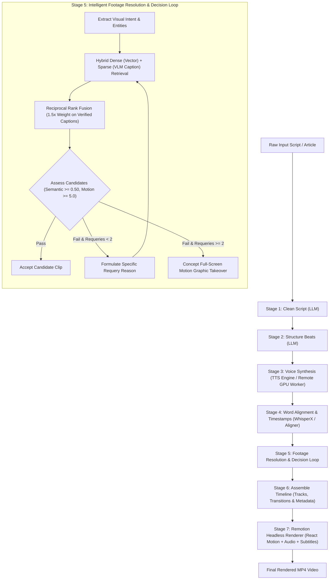
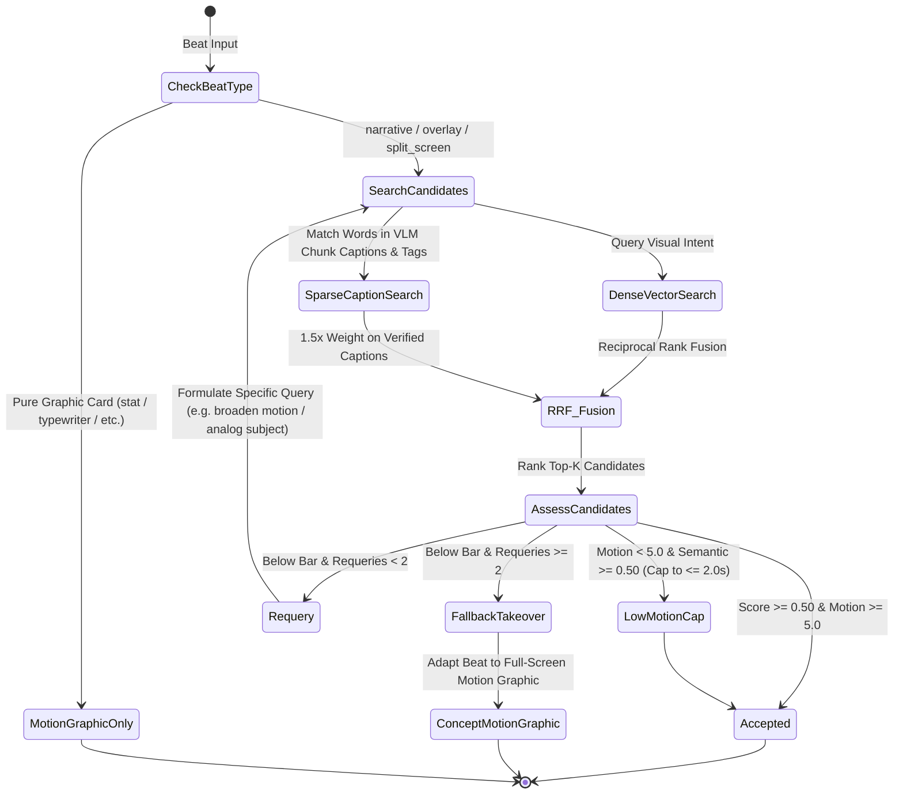

# Video Generation Pipeline — Architecture & Decision Flow

This document details the complete end-to-end pipeline flow, data models, and decision-making logic used in the Video Generation Pipeline.

---

## 1. High-Level Pipeline Architecture

---

## 2. Step-by-Step Stage Breakdown

### Stage 1: Clean Script (`clean_script`)
- **Input**: Raw, messy text, markdown notes, URLs, or articles containing mixed stage directions, timestamps, speaker tags, or formatting noise.
- **Process**: LLM cleans and extracts pure, spoken narration text suitable for TTS engines.
- **Single-Pass Optimization**: In `--single-pass` mode, Stage 1 and Stage 2 are merged into a single LLM invocation to reduce API latency.

### Stage 2: Beat Structuring (`structure_beats`)
- **Input**: Cleaned narration text, channel style profile, and genre.
- **Process**:
  - Segments long scripts into atomic narrative beats (typically 3–7 seconds each, 1–2 sentences).
  - Assigns `beat_type`:
    - `narrative`: Standard voiceover over video footage.
    - `stat`: Key numerical figure or statistic to emphasize.
    - `quote`: Direct quote or testimony.
    - `abstract`: Metaphorical or conceptual beat.
    - `typewriter`, `swipe_deck`, `chat_bubbles`, `map_explainer`: Visual graphic templates.
  - Extracts `visual_intent`: Explicit description of what should be visually depicted (e.g., *"Macro close-up of octopus tentacles feeling a rocky crevice"*).
  - Determines mood / emotion tags (`dramatic`, `mysterious`, `educational`, `calm`).
  - Sets initial `footage_status = PENDING`.

### Stage 3: Voice Synthesis (`synthesize_voice`)
- **Input**: Beat text, selected TTS provider, and voice profile / clone reference.
- **Engines Supported**:
  - **OmniVoice**: State-of-the-art zero-shot voice cloning using reference audio (`.mp3` + `.txt`) or emotion/style instruct prompts. Runs on GPU.
  - **Kokoro**: Ultra-fast, lightweight 82M parameter neural TTS.
  - **Supertonic / Supersonic**: High-speed, high-fidelity neural voice generation.
  - **Chatterbox**: Conversational expressiveness.
- **Execution Routing**:
  - **Local Execution**: Kokoro and Supertonic run in-process locally.
  - **Remote GPU Worker**: For heavy models like OmniVoice, jobs are submitted to the PostgreSQL queue (`tts_synthesize`). Active Google Colab or Kaggle GPU workers claim the task, run synthesis, and return the audio via `base64` or `ngrok` transport.
  - **Seamless Local Fallback**: If remote workers are offline, the pipeline automatically falls back to local Kokoro without crashing.

### Stage 4: Word Alignment & Timestamps (`extract_timestamps`)
- **Input**: Synthesized `.wav` audio clips for each beat and corresponding beat text.
- **Process**: Uses forced alignment (WhisperX / EasyTranscriber / Phoneme alignment) to extract exact start and end timestamps (`start_sec`, `end_sec`) for each individual spoken word.
- **Downstream Utility**:
  - Sets the exact video beat duration on the timeline.
  - Drives word-level synchronized kinetic subtitle overlays.

---

## 3. Stage 5: Caption-Aware Footage Resolution & Decision Loop

The footage resolution stage is not a simple static lookup; it is an intelligent, multi-step search, assessment, and fallback decision loop.

### A. Pre-Indexing with Vision-Language Models (VLM)
Footage chunks in the database are pre-indexed with two modalities:
1. **Dense Vector Embeddings**: Visual feature embeddings (Qwen2-VL / XCLIP / Milvus).
2. **VLM Chunk Captions**: GPU workers (Qwen3-VL-2B-Instruct) inspect raw video chunks and generate:
   - Detailed visual descriptions (e.g., *"Underwater shot of a common octopus swimming over coral reef, tentacles trailing"*).
   - Semantic tags (e.g., `["octopus", "tentacles", "underwater", "ocean floor", "marine life"]`).

### B. Hybrid Dense + Sparse Retrieval (RRF)
When resolving footage for a beat:
1. **Dense Vector Search**: Queries vector store for semantic similarity.
2. **Sparse Caption Search**: Matches keywords from `visual_intent` against PostgreSQL `chunks.caption` and `chunks.tags`.
3. **Reciprocal Rank Fusion (RRF)**:
   $$\text{RRF Score} = \frac{1.0}{60 + \text{Rank}_{\text{dense}}} + 1.5 \times \frac{1.0}{60 + \text{Rank}_{\text{caption}}}$$
   Verified caption matches carry **1.5x weighting**, dramatically reducing false positives (e.g., distinguishing an octopus tentacle from generic dark ocean water).

### C. Assess & Decide Engine
Every candidate is tested against:
- **Semantic Threshold** ($\ge 0.50$): Must semantically represent the visual intent.
- **Motion Dynamism Floor** ($\ge 5.0$): Discards static loops, frozen freeze-frames, or still images masquerading as video.
- **Low-Motion Capping**: If a clip has strong semantic relevance ($\ge 0.50$) but low motion dynamism ($< 5.0$), it is accepted but its duration is capped to $\le 2.0$ seconds to keep the video pacing energetic.

### D. Requery & Motion Graphic Fallback Loop
- **Specific Requery**: If no candidate clears the bar and `requery_count < 2`, the LLM formulates a targeted query adjustment (distinguishing between subject mismatch vs. static motion).
- **Motion Graphic Takeover**: If candidates are still inadequate after 2 requeries (`footage_status == INADEQUATE`), the system gracefully defaults to a full-screen Remotion motion graphic takeover (`concept_motion_graphic`), ensuring the video never stalls or uses bad footage.

---

## 4. Stage 6: Timeline Assembly & Subtitle Layer

### Timeline Structure
`assemble_timeline` produces a standardized `TimelinePlan` with multiple parallel tracks:
1. **`video` Track**: Resolved video clips with `start_sec`, `end_sec`, `in_point`, `out_point`, `source_url`, and scaling `fit_mode` (`cover` / `contain`).
2. **`audio` Track**: Beat-by-beat voiceover audio clips, background music (BGM), and transition sound effects (SFX).
3. **`text` Track (Captions & Overlays)**:
   - Kinetic word-by-word subtitles synchronized to speech timestamps.
   - Text callouts, stat labels, and quote cards.
4. **`transitions`**: Dynamic transitions between clips (e.g., `whip_pan`, `glitch_vhs`, `camera_shake`, `flash_white`, `crossfade`).

### Subtitle / Caption Decision Controls
Subtitles can be conditionally rendered or suppressed depending on delivery format:
- **Default Behavior**: Kinetic word-by-word subtitles are automatically generated for all voiceover beats.
- **Suppression Flags**:
  - CLI: `--no-captions` / `--no-subtitles`.
  - Timeline Metadata: `timeline.metadata["no_captions"] = True`.
  - Renderer: Remotion skips the `KineticCaptions` layer and omits text items from the text track, yielding clean video for archival or international dubbing.

---

## 5. Stage 7: Headless Remotion Renderer & Distributed Workers

### Headless Remotion Renderer (`render_video.mjs`)
- Executes in headless Chromium via Node.js and Remotion CLI.
- Compiles React motion components, canvas animations, and Web Audio synchronously frame-by-frame into final MP4.
- Resolves asset paths, pre-caches remote footage, and avoids 1-frame black flashes through deterministic frame scheduling.

### Distributed Render Workers
- High-throughput rendering can be offloaded to Colab CPU instances or Kaggle background workers via the `render_video` task queue.
- If remote render workers are absent or busy, rendering falls back seamlessly to the local machine.
